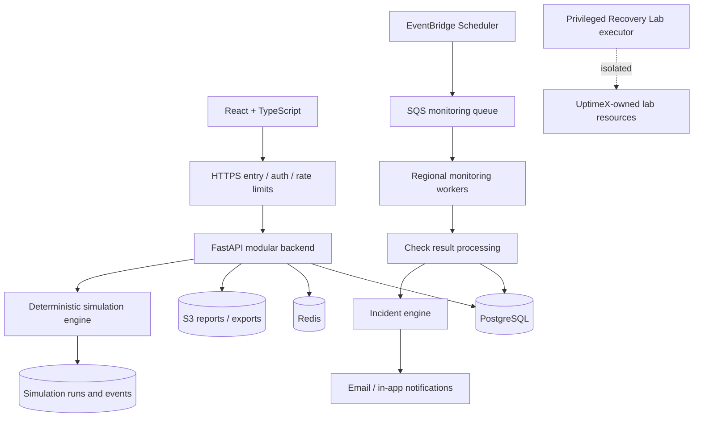
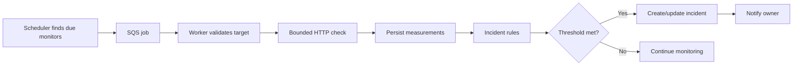
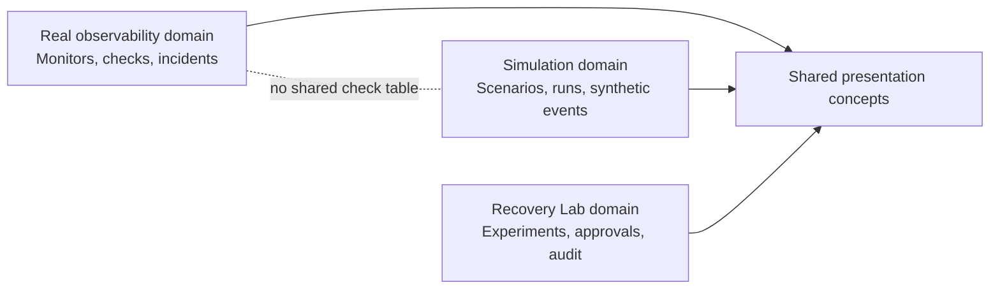

# UptimeX — Expanded Product Requirements Document

**Tagline:** The Internet’s Health, Under One Roof.  
**Version:** 1.0 · 19 November 2026  
**Target build horizon:** 12–16 weeks  
**Primary cloud:** AWS

> UptimeX is a cloud-native website observability, incident intelligence and infrastructure resilience learning platform. This is a proposed specification, not a claim that features are already implemented.

## Executive summary

UptimeX combines three clearly separated experiences:

1. **Observe:** real monitoring of public websites the user owns or is authorized to monitor.
2. **Playground:** deterministic, safe simulations that teach cloud failure and recovery concepts.
3. **Recovery Lab:** privileged, controlled demonstrations on UptimeX-owned isolated AWS resources.

Real checks, synthetic simulation events and lab telemetry must remain distinguishable in both storage and UI.

## Product vision and principles

- Make website reliability understandable and cloud resilience tangible.
- Evidence before explanation: separate observed facts from hypotheses.
- Never mix real and simulated data.
- Safe by default: public HTTP(S) endpoints only, bounded requests, SSRF controls.
- Progressive disclosure: plain-language summaries first, technical detail on demand.
- Build for operability: UptimeX monitors its own API, workers, queues and cleanup processes.

## Product modules

### Observe
- Add, edit, pause, resume and remove website monitors.
- Bounded HTTP(S) health checks.
- Capture HTTP status, DNS/TCP/TLS timings, TTFB, total response time, region and timestamp.
- Show UP, DEGRADED, DOWN, UNKNOWN and PAUSED.
- Availability, downtime estimate, average/median/p95 latency and regional comparison.
- Email and in-app notifications.
- Incident history and optional public status pages.

Proposed initial defaults: 5-minute check interval, 10-second timeout, three consecutive failures to declare DOWN, two successful checks to resolve, and a quota of 10 monitors per initial free account. These are tunable product defaults, not guarantees.

### Incident management and Incident Detective
- Idempotent incident creation from configured thresholds.
- Lifecycle: Detected → Investigating → Identified → Recovering → Resolved.
- Append-only event timeline.
- Evidence includes HTTP status, categorized errors, timing breakdowns, regions and recovery observations.
- Explanations distinguish facts, interpretations and unknowns. Do not claim exact root cause from HTTP evidence alone.

### Disaster Playground
A deterministic simulator with isolated run state and synthetic provenance.

Initial scenarios:
- Server overload: capacity, load balancing and auto-scaling.
- Database unavailable: dependencies, failover and graceful degradation.
- Network latency: timeouts, retries and circuit breakers.
- Application crash: health checks and replacement.
- Regional outage: failure domains and traffic shifting.
- Queue backlog: asynchronous processing and consumer scaling.

Modes: manual experiment, automatic recovery, challenge mode and guided walkthrough. At least three repeatable scenarios should ship in the first Playground release.

### Recovery Lab
Real operations only against UptimeX-owned, tagged and isolated lab infrastructure. Disabled by default; requires privileged authorization, pre-approved templates, explicit approval, cost limits, time limits, audit logs, emergency stop and verified cleanup. Never target customer production or arbitrary third-party systems.

## User journeys

1. Register → add public URL → validate URL safely → create monitor → schedule check → worker measures endpoint → dashboard displays real result.
2. Threshold met → incident opened → evidence timeline populated → user notified → recovery threshold met → incident resolved.
3. Select simulation → isolated deterministic run → trigger scenario → view synthetic metrics and event timeline → review learning summary.
4. Select lab template → inspect scope/cost/permissions → approve → execute against allow-listed resources → collect telemetry → clean up and verify.

## UX and visual direction

- Modern, calm, technical and approachable SaaS interface.
- Deep navy/charcoal background, lighter surfaces, electric teal primary accent and violet for learning/simulation.
- Green/amber/red status colours must always be paired with text or icons.
- Typography: Inter or Geist.
- Responsive sidebar + content canvas.
- Navigation: Overview, Websites, Global Monitor, Incidents, Playground, Recovery Lab, Analytics, Settings.
- Every relevant screen visibly labels data as **REAL**, **SIMULATED** or **LAB**.
- Keyboard access, readable contrast, focus indicators and accessible chart summaries.

## Technology stack

| Layer | Choice | Purpose |
|---|---|---|
| Frontend | React + TypeScript + Vite | Dashboard and interaction |
| Styling | Tailwind CSS | Design system |
| Charts | Recharts | Analytics |
| Topology | React Flow or SVG | Infrastructure visualization |
| API | Python + FastAPI | Modular backend |
| Validation | Pydantic | Request/config validation |
| ORM/migrations | SQLAlchemy + Alembic | Data layer |
| Database | PostgreSQL | Relational product data |
| Cache | Redis | Cache/ephemeral coordination |
| Queue | AWS SQS | Async monitoring jobs |
| Scheduler | EventBridge Scheduler | Due-check scheduling |
| Compute | ECS Fargate | API and worker containers |
| Storage | S3 | Reports and exports |
| Email | Amazon SES | Transactional alerts |
| Telemetry | CloudWatch + OpenTelemetry | Logs, metrics, traces |
| IaC | Terraform | Reproducible infrastructure |
| CI/CD | GitHub Actions | Test/build/deploy |
| Containers | Docker | Consistent runtime |
| Tests | Pytest, Vitest, Playwright | Unit, API and E2E |

### Architecture style

Use a **modular monolith** for the API, with separately deployed monitoring and notification workers. Do not start with many microservices. ECS Fargate is the initial compute target; Kubernetes is a later optional learning milestone.

## System architecture



### Real monitoring workflow



### Data-domain separation



## Database design

Core tables:

| Table | Main fields | Purpose |
|---|---|---|
| users | id, email, auth_subject, created_at | Identity reference |
| monitors | id, user_id, name, target_url, interval, status | Monitor configuration |
| monitor_checks | id, monitor_id, job_id, region, outcome, timings, checked_at | Real measurements |
| incidents | id, monitor_id, status, severity, started_at, resolved_at | Incident lifecycle |
| incident_events | id, incident_id, event_type, payload, created_at | Timeline |
| notification_channels | id, user_id, type, destination, verified_at | Destinations |
| notifications | id, incident_id, channel_id, status, attempts | Delivery |
| simulation_scenarios | id, version, name, config_json | Scenario definitions |
| simulation_runs | id, user_id, scenario_id, seed, status | Simulation sessions |
| simulation_events | id, run_id, sequence, event_type, payload | Synthetic event stream |
| lab_experiments | id, user_id, template_id, approval_state, status | Lab executions |
| lab_audit_events | id, experiment_id, actor, action, resource_ref | Audit trail |

Relationships: users own monitors and notification channels; monitors have checks and incidents; incidents have events and notification deliveries; scenarios have runs; runs have ordered events; lab experiments and audit events form a separate privileged domain.

Suggested indexes:
- `monitors(user_id, status)`
- `monitor_checks(monitor_id, checked_at DESC)`
- `monitor_checks(region, checked_at DESC)`
- `incidents(monitor_id, status, started_at DESC)`
- `incident_events(incident_id, created_at)`
- `simulation_runs(user_id, started_at DESC)`
- `simulation_events(run_id, sequence)`

Use UUID primary keys, UTC timestamps and `TIMESTAMPTZ`. Consider time partitioning for high-volume check history. Define retention, deletion and backup policy.

## API surface

All routes use `/api/v1`, JSON, validation, ownership enforcement, pagination and consistent machine-readable errors.

| Method | Route | Purpose |
|---|---|---|
| POST | `/monitors` | Create monitor |
| GET | `/monitors` | List monitors |
| GET | `/monitors/{id}` | Monitor detail |
| PATCH | `/monitors/{id}` | Update |
| DELETE | `/monitors/{id}` | Delete/archive |
| POST | `/monitors/{id}/pause` | Pause |
| POST | `/monitors/{id}/resume` | Resume |
| GET | `/monitors/{id}/checks` | Check history |
| GET | `/monitors/{id}/analytics` | Analytics |
| GET | `/incidents` | List incidents |
| GET | `/incidents/{id}` | Incident detail |
| GET | `/incidents/{id}/events` | Timeline |
| GET | `/simulations/scenarios` | Scenario catalogue |
| POST | `/simulations/runs` | Start simulation |
| GET | `/simulations/runs/{id}` | Run state |
| POST | `/simulations/runs/{id}/actions` | Allowed action |
| POST | `/simulations/runs/{id}/stop` | Stop run |
| GET | `/status-pages/{slug}` | Public status page |

Recovery Lab APIs must be separate, privileged and narrowly scoped.

## Security and privacy

### SSRF controls
- Only HTTP/HTTPS; reject unusual schemes and embedded credentials.
- Resolve hostnames and reject loopback, private, link-local, multicast, reserved and cloud metadata addresses.
- Revalidate every redirect and DNS resolution; defend against DNS rebinding by validating the actual connection destination.
- Restrict outbound ports, request duration and response size.
- Use worker egress controls and isolate workers from internal control-plane services.
- Enforce account quotas, rate limits and concurrency limits.

### Identity and data
- Use a managed identity provider or vetted auth implementation.
- Enforce tenant isolation on every read/write.
- Use least-privilege IAM; separate API, worker and lab roles.
- Store secrets in Secrets Manager; never commit credentials.
- Encrypt data in transit and at rest; redact sensitive log fields.
- Avoid storing response bodies by default.
- Audit privileged actions and lab operations.

## Reliability and observability

UptimeX must monitor itself:
- API availability, request latency and errors.
- Worker heartbeat and check throughput.
- Queue depth and oldest-message age.
- DLQ message count.
- Scheduler lag.
- Database connections and query latency.
- Notification delivery failures.
- Recovery Lab cleanup status.

Use structured logs, metrics and traces. Apply bounded retries with exponential backoff and jitter, idempotent consumers, dead-letter queues and operator-visible replay. Treat missing/stale check data as UNKNOWN, not UP.

Proposed initial targets (not achieved claims): API availability 99.5% monthly, common read API p95 under 500 ms, dashboard initial load under 3 seconds under typical conditions.

## Testing strategy

- Unit: uptime math, status classification, thresholds and simulation transitions.
- API: validation, authentication, ownership, pagination.
- Worker: DNS, TLS, timeout, redirects and response cap.
- Queue: retry, duplicate delivery, DLQ and idempotency.
- Security: SSRF, DNS rebinding, cross-tenant access and secret leakage.
- E2E: register → add monitor → observe → incident → recovery.
- Infrastructure: Terraform plan review, least privilege, rollback and cleanup.
- Simulation: deterministic repeatability, stop/reset and provenance separation.

## Deployment and CI/CD

Environments:
- Local: Docker Compose.
- Staging: small AWS deployment with test data.
- Production: hardened AWS deployment.
- Recovery Lab: isolated account or strict boundary.

Repository:

```text
uptimex/
  frontend/
  backend/app/{api,core,models,schemas,services,repositories,incidents,simulations}/
  backend/migrations/
  workers/{monitoring,scheduler,notifications}/
  infrastructure/terraform/{modules,environments,global}/
  tests/{unit,integration,security,e2e}/
  docs/{architecture,api,database,decisions}/
  .github/workflows/
  docker-compose.yml
  .env.example
  README.md
```

CI/CD: Commit/PR → lint/type check → unit tests → image build → security checks → staging deploy → integration tests → approval → production deploy → post-deploy health checks.

Terraform scope: VPC/networking, ECS, ALB, RDS, SQS/DLQ, EventBridge, S3, IAM, Secrets Manager, CloudWatch and budgets.

## Cost management

- Configure AWS Budgets before deployment.
- Tag resources by environment, owner and service.
- Limit monitor count and check frequency.
- Retain raw checks for a defined period and aggregate older data.
- Apply S3 lifecycle rules.
- Scale workers with queue depth but enforce maximum capacity.
- Expire and clean up lab resources automatically.
- Track cost per monitor per day and cost per thousand checks.
- Review cross-region data-transfer cost before expanding regions.

## Roadmap: 12–16 weeks (indicative)

| Phase | Timing | Deliverable |
|---|---|---|
| 0. Foundation | Week 1 | Repo, React, FastAPI, Docker, PostgreSQL, health endpoint |
| 1. Observatory | Weeks 2–3 | Auth, monitor CRUD, safe URL validation, worker, checks and charts |
| 2. Distributed monitoring | Weeks 4–5 | SQS, EventBridge, ECS, retries, DLQ and regional workers |
| 3. Incident intelligence | Weeks 6–7 | Thresholds, lifecycle, timeline, notifications and Detective |
| 4. Playground | Weeks 8–9 | Scenario engine, three scenarios, topology and challenge mode |
| 5. Recovery Lab | Weeks 10–12 | Isolated lab, Terraform templates, approvals, audit and cleanup |
| 6. Production polish | Weeks 13–16 | Security, tests, backups, cost controls, docs and public demo |

### Engineering approach
- Build vertical slices, not disconnected layers.
- Test features as they are implemented.
- Treat security, tenant isolation and cost controls as foundation work.
- Use Terraform for repeatable infrastructure.
- Add observability as each service is introduced.
- Record architecture decisions and trade-offs.
- Keep Kubernetes and microservice extraction as deliberate later decisions.

## Acceptance criteria

- User can register and authenticate.
- User can add, pause, resume and remove a public website monitor.
- Backend and worker reject prohibited URL destinations.
- Workers perform bounded real checks and persist results.
- Dashboard displays real state, timestamps and response history.
- Incidents are created and resolved using configured thresholds.
- Duplicate job delivery does not create duplicate incidents.
- Notifications record delivery status.
- Playground has at least three deterministic scenarios.
- Real, simulated and lab data are clearly separated.
- UptimeX detects stale workers and queue backlogs.
- Critical workflows have automated tests.
- Staging deployment is reproducible from infrastructure code.

## Risks

| Risk | Mitigation |
|---|---|
| SSRF / unsafe target access | DNS/IP validation, redirect checks, egress isolation and quotas |
| False downtime alerts | Consecutive thresholds, regional comparison and UNKNOWN state |
| Worker/scheduler outage | Heartbeats, queue-age alarms and DLQ |
| Database growth | Retention, aggregation, partitioning and indexes |
| Cloud cost surprises | Budgets, quotas, tags and cleanup |
| Real/simulated data confusion | Separate schemas, APIs, provenance and UI labels |
| Lab resource leakage | Dedicated account, expiry and cleanup verification |
| Overengineering | Modular monolith, phased delivery and extraction criteria |

## Future roadmap
Kubernetes worker deployment, browser checks, AI-assisted evidence-linked summaries, Slack/Discord/webhooks, team RBAC, SLOs/error budgets, multi-region application failover and custom status pages.

## Definition of done
A feature is done when it is implemented and reviewed, tested, authorized, observable, documented, deployable, cost/security-reviewed and has a rollback or cleanup path where applicable.
